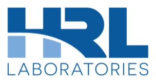
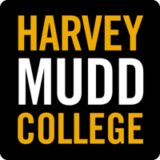

::: {.grid .hero}
::: {.g-col-12 .g-col-md-8}
# Drake Gonzales {.hero-name}

### RF & Digital Design Engineer {.hero-title}

I'm a senior Engineering major at Harvey Mudd College, emphasizing electrical,
RF, and computer engineering. I work on the part of hardware where the math
stops being tidy — impedance matching and filter design on the RF side, FPGA
and RISC-V processor design on the digital side, and the gap between what a
simulation predicts and what the network analyzer actually shows you.

[GitHub](https://github.com/Swayngee) ·
[LinkedIn](https://www.linkedin.com/in/drake-gonzales-a953092a6/) ·
[Email](mailto:drgonzales@g.hmc.edu) ·
[Resume](files/Drake_Gonzales_Resume.pdf)
:::

::: {.g-col-12 .g-col-md-4}
{style="width:100%;height:300px;object-fit:cover;object-position:center 22%;border-radius:8px;"}
:::
:::

## Experience

::: {.xp}
::: {.xp-logo}
{fig-alt="HRL Laboratories"}
:::
::: {.xp-body}
[Quantum Instrumentation Control Kit (QICK)]{.xp-role}
[HRL Laboratories / IBM · Clinic Program]{.xp-org}

Replacing the QICK tProcessor with a standardized **RISC-V-based quantum-control
architecture** for real-time control of superconducting and spin qubit
experiments, targeting a **Xilinx UltraScale+ RFSoC**. Working directly with HRL
and Fermilab engineers to keep the design compatible with the existing QICK and
spinQICK APIs while supporting precise timing, waveform generation, and
pulse-level control.
:::
::: {.xp-date}
Aug 2026 — Present
:::
:::

::: {.xp}
::: {.xp-logo}
{fig-alt="The Aerospace Corporation"}
:::
::: {.xp-body}
[GPS IV]{.xp-role}
[The Aerospace Corporation / FAA · Clinic Program]{.xp-org}

Modeled future **Laser Inter-Satellite Link (LISL)** architectures for GPS IV
using SOAP, analyzing orbital geometry, link availability, pointing
requirements, and relative satellite motion to identify viable configurations.
Presented the orbital-geometry and system-level trade-off findings to engineers
at Aerospace's Concurrent Design Center. *(ITAR)*
:::
::: {.xp-date}
Jan 2026 — May 2026
:::
:::

::: {.xp}
::: {.xp-logo}
{fig-alt="Roncelli Technologies"}
:::
::: {.xp-body}
[Student Intern]{.xp-role}
[Roncelli Technologies]{.xp-org}

AI-driven automation, PLC and CNC programming, robotic automation, and process
optimization. Worked with the SMDT team analyzing ERP, Industrial IoT, and
production flows.
:::
::: {.xp-date}
Summer 2026
:::
:::

::: {.xp}
::: {.xp-logo}
{fig-alt="Harvey Mudd College"}
:::
::: {.xp-body}
[Autonomous Drone Research]{.xp-role}
[Harvey Mudd College · MADD Lab]{.xp-org}

Designed a **multi-UAV wildfire inspection system** on embedded platforms, and
built the thermal and RGB computer-vision pipelines around a YOLOv8 model,
reaching **up to 70% fire-detection accuracy**.
[Read the project →](projects/wildfire-drone.qmd)
:::
::: {.xp-date}
Jan 2025 — Jan 2026
:::
:::

## Projects

::: {#featured}
:::

[See all projects →](projects.qmd)
