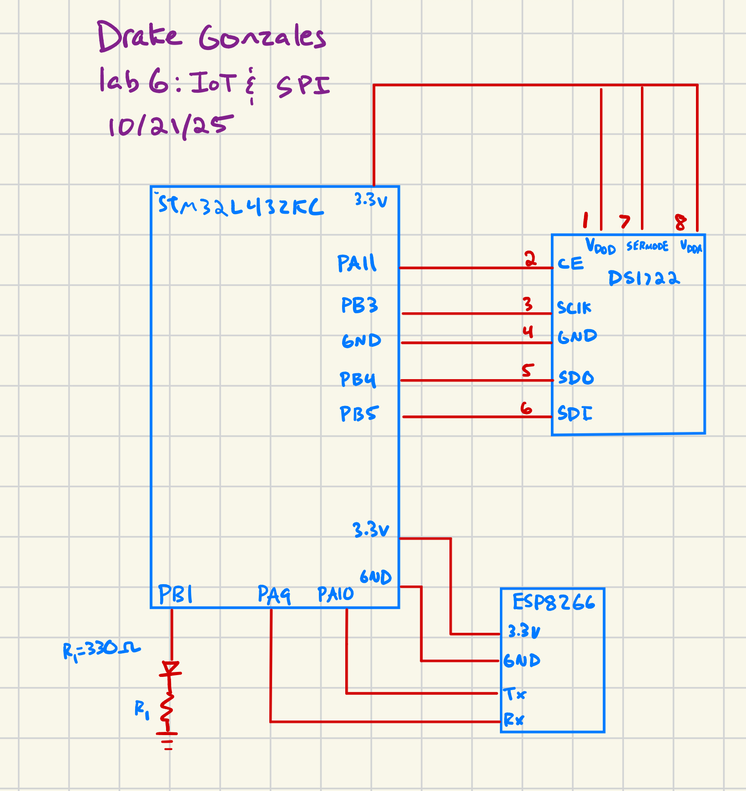

## Lab 7 - The Advanced Encryption Standard (AES)

## Introduction

In this lab, a design was made to use a microcontroller and an FPGA to implement the Advanced Encrypton Standard (AES). AES is a complicated method in which a message is encrypted and decrypted in a non-linear way. This is done such that messages/ communication as a whole can be done in secret. This standard has two inputs, a key, and a plaintext message, and outputs a done signal and a encrpted message. In this lab only the encryption was done, but the decryption can be done by completing the steps in opposite order. These steps include keyexpansion, switching the rows of the encryption message matrix, mixing the columns, and mixing in they expanded key every round. This standard is very complicating when it comes to ensuring clock signals line up, and inputs/outputs/enablers work as intended. 

The design was developed using C on SEGGER, and implemented on an STM32L432KC Microcontroller. 

## Technical Documentation 

The source code for this lab can be found in this [GitHub repo](https://github.com/Swayngee/e155-lab1/tree/main/fpga/src/lab7).

The documentation for the STM32L432KC manual [Github link](https://hmc-e155.github.io/assets/doc/rm0394-stm32l41xxx42xxx43xxx44xxx45xxx46xxx-advanced-armbased-32bit-mcus-stmicroelectronics.pdf).

The documentation for the AES [Github link](https://hmc-e155.github.io/assets/doc/NIST.FIPS.197-upd1.pdf).

## Equations

There were no equations used for this lab. 

## Testbenches

Below are the testbecnhes completed for the core, and SPI modules for this design. These modules acted like a 'top' module for our design and tested the two sections within our design. The core represented the code written for the AES implementation and the Spi was the communication protocol used between the FPGA and the MC. Below is the core testbench:

Above portrays the Inputs and outputs from the fsm for the core module. 

Above is the expected and the actual values coming out from our Core module. This verified that our AES implementation was correct. The testbench was condensed to this version to compare results only. 

Above is the SPI testbench for lab 7. It shows the expected vs the actual and other signals useful for the transaction. 

Above is the testbench for the subbytes module.

## Finite State Machines (FSM)

## Wiring Schematic

Above pictures the electrical circuit for our design. It portrays resistors, and all other electrical components used for the design. 

