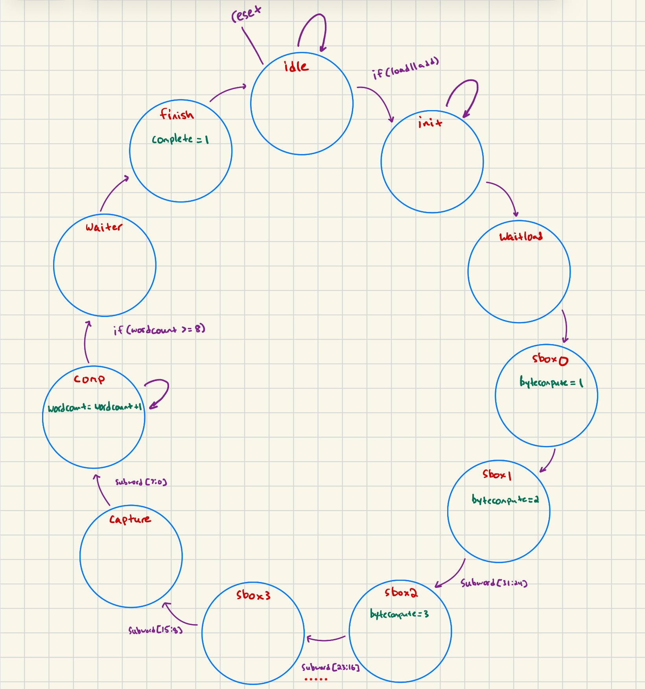
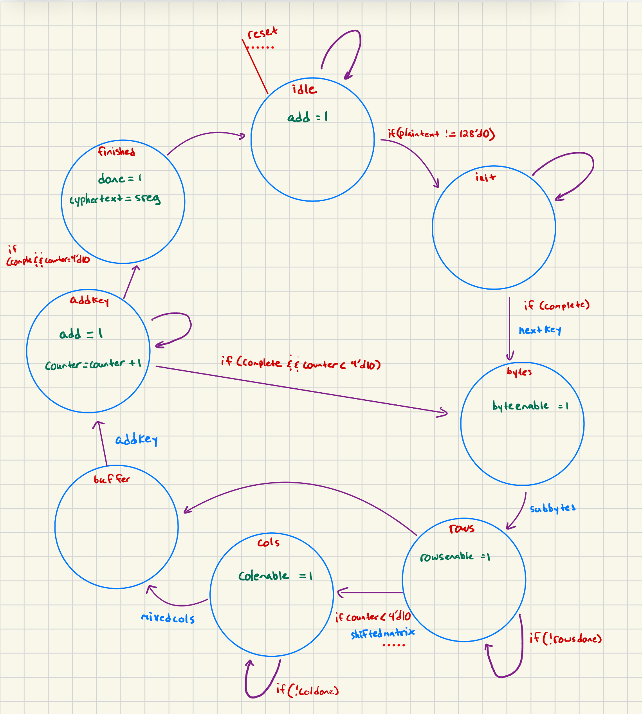
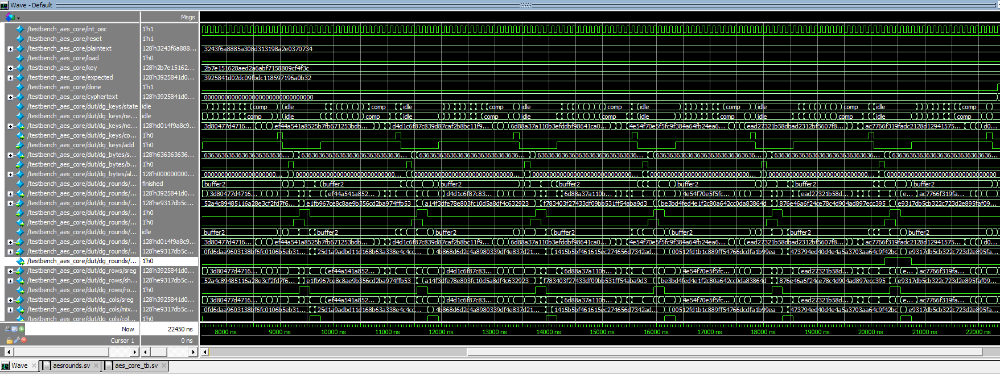
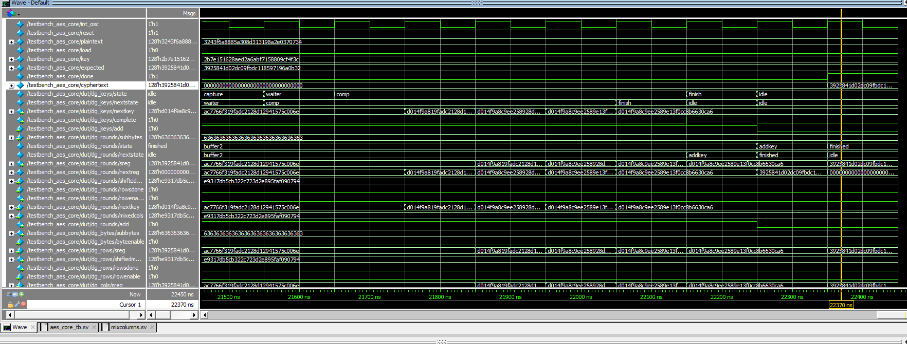
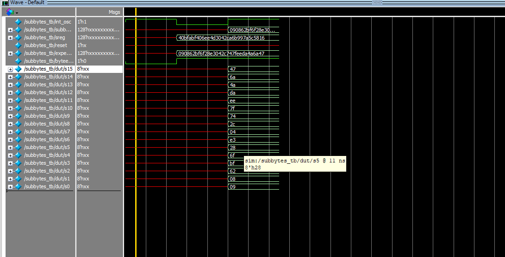
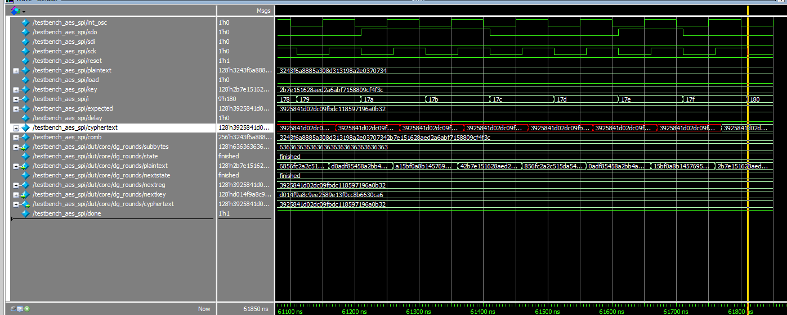

AES-128 encryption built in hardware: the microcontroller holds the key and
plaintext and acts as the SPI master, and the FPGA does the actual cipher —
eleven round keys, ten rounds of substitution, permutation, and mixing — then
raises `done` and shifts the ciphertext back out.

## Why It's Harder Than It Looks

The cipher itself is well specified; FIPS-197 tells you exactly what to compute.
The difficulty is that AES is a *sequencing* problem wearing a math problem's
clothes. Two FSMs have to run against each other without ever disagreeing about
what cycle it is:

- **Key expansion** derives eleven 128-bit round keys from the original key,
  each one depending on the last.
- **The round FSM** walks the state matrix through ten rounds, and round *i*
  needs round key *i* to be ready and stable at exactly the right cycle.

On top of that, the SPI shift register is clocked by the *microcontroller's*
clock while the core runs on the FPGA's, so the plaintext and key have to be
safely handed across a clock boundary before the core starts, and the ciphertext
handed back after `done`.

## Structure

| Module | Role |
|:--|:--|
| `aes_core.sv` | Top-level cipher, sequences the ten rounds |
| `keyexpansion.sv` | Generates the eleven round keys |
| `subbytes.sv`, `sbox.sv`, `sbox_sync.sv` | Byte substitution through the S-box |
| `shiftrows.sv` | Row-wise cyclic permutation of the state |
| `mixcolumns.sv`, `galoismult.sv` | Column mixing in GF(2⁸) |
| `aes_spi.sv` | SPI slave and the clock-domain handoff |

`galoismult.sv` is the one piece of real arithmetic: MixColumns multiplies in
GF(2⁸), which in hardware is a shift plus a conditional XOR with `0x1B` when the
high bit falls off.

Only encryption is implemented. Decryption is the same structure with the steps
inverted and run in reverse order.

## Verification

Every module was tested separately before anything was assembled, because a
wrong byte in round 3 is indistinguishable from a wrong byte in round 9 once
the output is scrambled.

## References

- [Source code](https://github.com/Swayngee/e155-lab1/tree/main/fpga/src/lab7)
- [NIST FIPS-197, the AES specification](https://hmc-e155.github.io/assets/doc/NIST.FIPS.197-upd1.pdf)
- [STM32L432KC reference manual](https://hmc-e155.github.io/assets/doc/rm0394-stm32l41xxx42xxx43xxx44xxx45xxx46xxx-advanced-armbased-32bit-mcus-stmicroelectronics.pdf)
