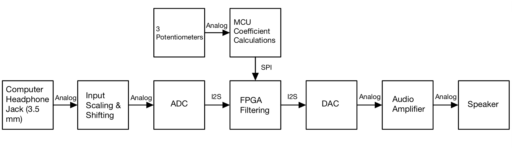
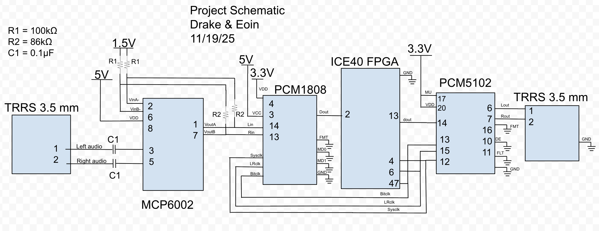

Audio goes in a 3.5 mm jack and comes out a speaker, and in between three
biquad IIR filters on an FPGA shape the low, mid, and high bands in real time.
Three potentiometers set the gains. Turning a knob changes the sound with no
audible delay, because the filter coefficients are recomputed on a
microcontroller and pushed to the FPGA over SPI while audio keeps streaming.

## The Interesting Problem

A biquad is five multiply-accumulates per sample:

$$y[n] = b_0x[n] + b_1x[n-1] + b_2x[n-2] - a_1y[n-1] - a_2y[n-2]$$

Three cascaded biquads is fifteen multiplies per sample. Laying that out as
fifteen parallel multipliers is the obvious approach and the wrong one — the
iCE40 UP5K has only eight hardened MAC16 DSP blocks, and inferring 16×16 signed
multipliers in soft logic would have eaten the fabric.

Instead, **each biquad time-multiplexes one MAC16 across all five of its terms.**
A nine-state FSM (`IDLE → WAIT1 → WAIT2 → MULT_B0 → MULT_B1 → MULT_B2 → MULT_A1 → MULT_A2 → DONE`)
walks the coefficients through the accumulator one per cycle while the DSP block
accumulates internally. A stage costs **one** DSP block instead of five
multipliers, so all three bands fit comfortably.

This works because of the clock-rate gap. Samples arrive at 63 kHz but the
system clock is orders of magnitude faster, so there are thousands of idle
cycles between samples — far more than the handful the FSM needs.

## Sample Timing

New samples are signalled by the I²S left/right clock rather than a counter.
`l_r_clk` is double-registered and XORed against its delayed copy to produce a
one-cycle edge pulse, which kicks the FSM out of `IDLE` and shifts the delay
line. Two wait states let the sample settle before the first multiply.

## Fixed-Point Format

Coefficients and samples are **Q2.14**: 16-bit signed, two integer bits, fourteen
fractional. Two integer bits matter — biquad feedback coefficients routinely
exceed 1.0, so a Q1.15 format would overflow. The MAC16 produces a 32-bit
product, and bits `[29:14]` are taken as the 16-bit result, which performs the
÷2¹⁴ descale and the truncation back to Q2.14 in a single wire assignment.

## The Microcontroller Side

The STM32 reads three potentiometers on its 12-bit ADC and computes biquad
coefficients from scratch (Q = 0.5, up to ±10 dB of cut or boost at
f~s~ = 63 kHz), converts them to Q2.14, and ships them over SPI.

One problem showed up immediately: **ADC noise made the audio chatter.** The
bottom bits of a 12-bit conversion wander even when nobody touches the knob, and
every wander recomputed the coefficients and audibly stepped the filter. The fix
was a 5-sample moving average per channel, plus a threshold near the top of the
ADC range (3850 of 4095) that snaps to full scale and a dead zone around 0.1 dB
that snaps to exactly unity gain. Knobs at their stops now produce clean,
stable values instead of dithering.

## Signal Chain

The analog front end exists because the PCM1808 ADC expects a signal centered in
its own input range, while a headphone jack delivers a small signal centered at
0 V. An MCP6002 op-amp with a resistor divider biases the audio up and scales it
to fit.

| Stage | Part |
|:--|:--|
| Input buffer / level shift | MCP6002 op-amp |
| ADC | PCM1808 (I²S out) |
| Filtering | iCE40 UltraPlus UP5K |
| DAC | PCM5102 (I²S in) |
| Coefficients | STM32L432KC over SPI |

## Verification

Each piece was tested on its own before integration: a testbench for the MAC16
wrapper against hand-computed products, one for a single biquad against a
reference implementation, and a full-chain testbench through all three cascaded
stages.

## Links

- [Final report](https://eoinoconnell04.github.io/E155-Portfolio/E155-Project/final_report.html)
- [Interactive frequency-response demo](https://eoinoconnell04.github.io/E155-Portfolio/E155-Project/bode_plot_demo.html)
- [Project repository](https://github.com/eoinoconnell04/E155-Project)
