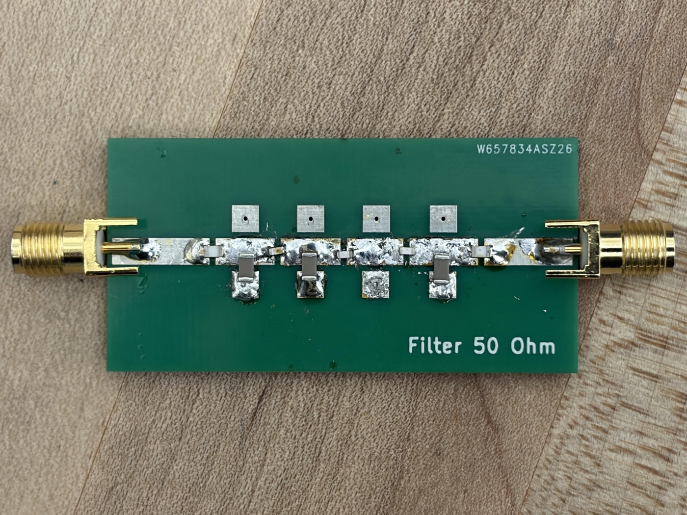

I designed, simulated, built, and measured a 5th-order Butterworth low-pass
filter with a 100 MHz passband edge. Butterworth for the maximally flat
passband; 5th order for −20·*n* dB/decade of rolloff. Normalized component
values (R~S~ = R~L~ = 1 Ω) come straight from the standard tables, scaled to the
100 MHz corner and the 50 Ω system impedance.

The design work was not choosing the component values. It was getting a board to
behave like the values.

## Results

| Parameter | Analytical | Simulated (ideal) | Simulated (real parts) | Measured |
|:--|:-:|:-:|:-:|:-:|
| Filter type | Butterworth | — | — | — |
| Filter order | 5 | — | — | — |
| Passband edge (1 dB ripple) | 100 MHz | 99.6 MHz | 110.2 MHz | 104 MHz |
| Stopband start (20 dB rejection) | 181.3 MHz | 180.6 MHz | 196.8 MHz | 197 MHz |
| Insertion loss | 0 dB | 0.00 dB | 0.17 dB | 0.1 dB |
| In-band ripple | 1 dB | 1.04 dB | 0.75 dB | 0.95 dB |

## Design

Normalized values for nearly every standard filter are already tabulated. You
pick the row matching your order, then denormalize to your corner frequency and
system impedance.

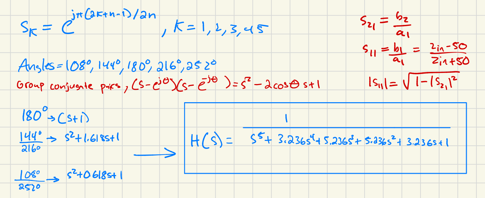

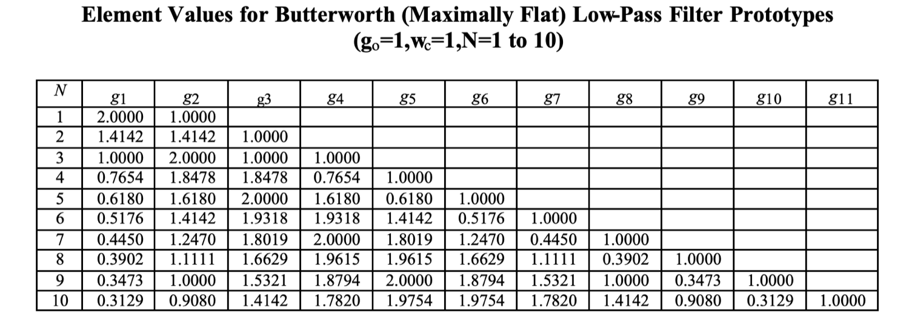

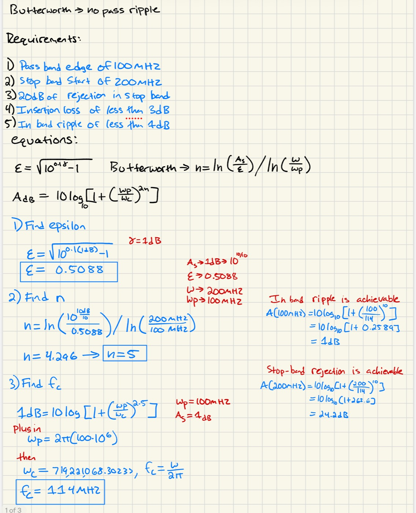

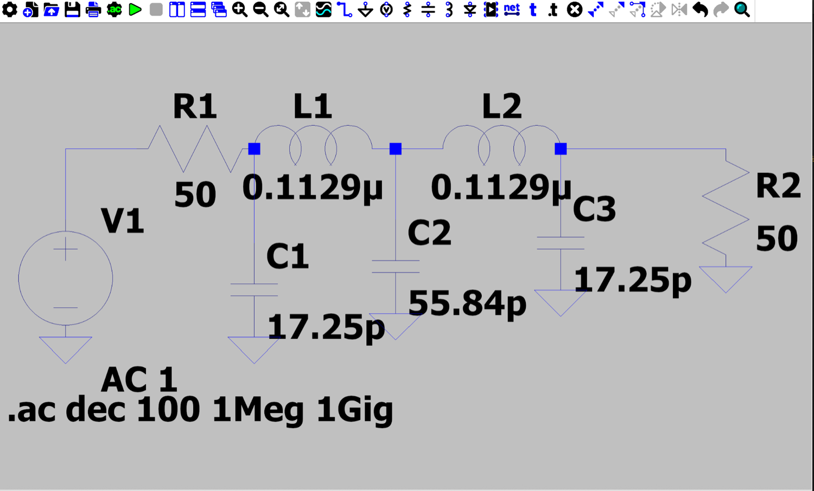

## Designing Around the Parts That Existed

I designed the filter before walking into the lab, assuming the inductors I
needed would be on the shelf. They weren't. The design called for two **112 nH**
inductors; the lab stocked **120 nH and 80 nH**.

Series-combining to reach 112 nH was the obvious move, but the board had a
limited number of series pads — enough to build *one* inductor near 112 nH,
leaving the other stuck at 120 nH or 80 nH.

So I went back to LTspice and swept each L and C individually until I understood
which part controlled which feature of the response. That turned a dead end into
a design problem with a solution: a set of real, in-stock values whose response
tracks the original closely.

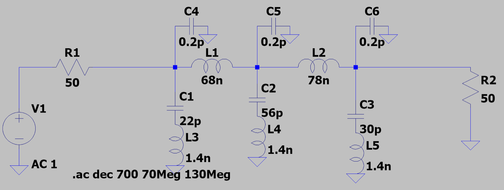

## Measured vs. Simulated

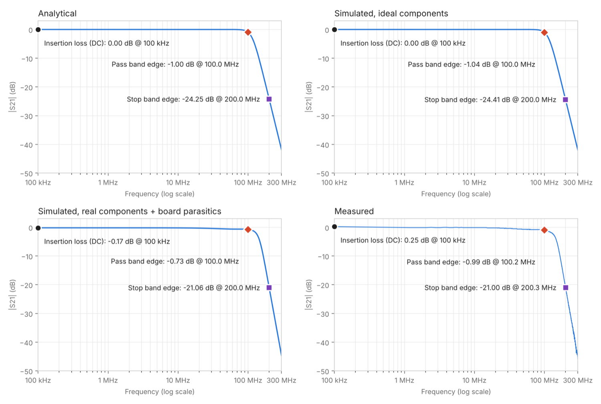

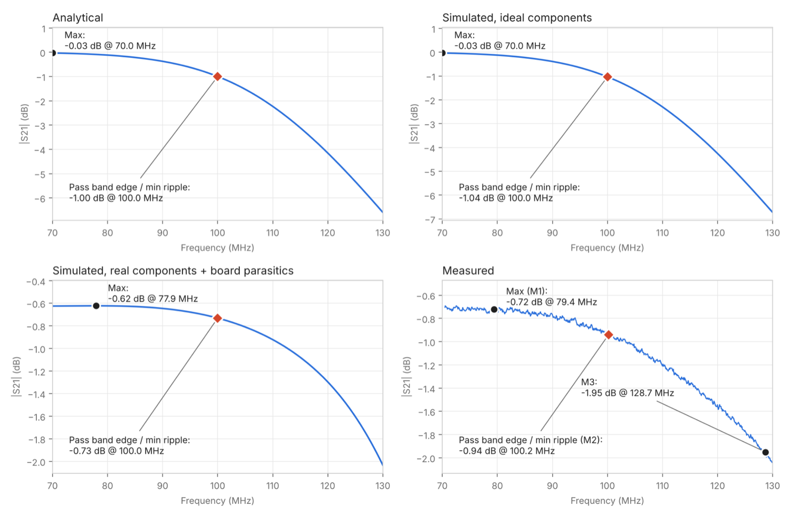

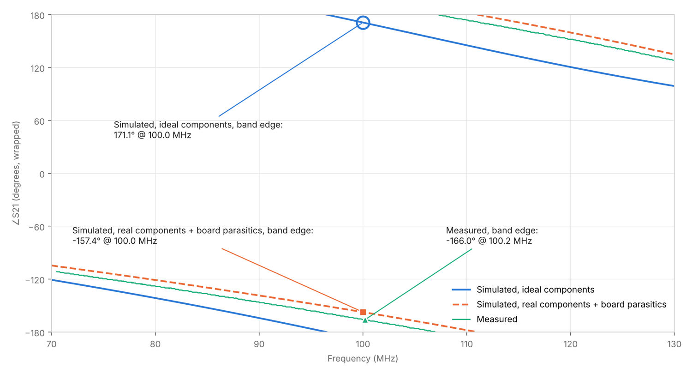

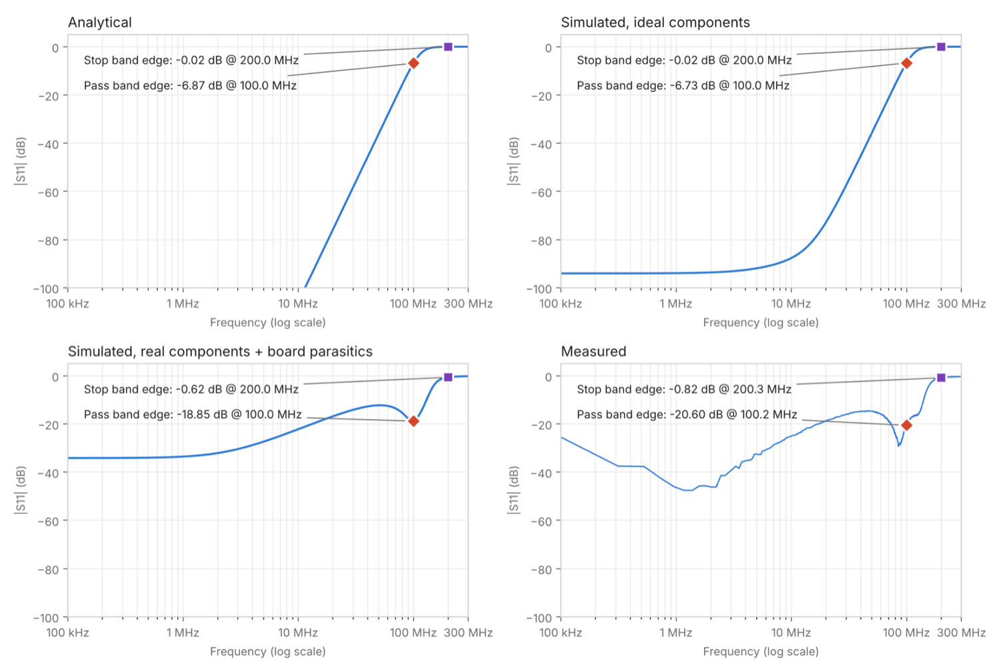

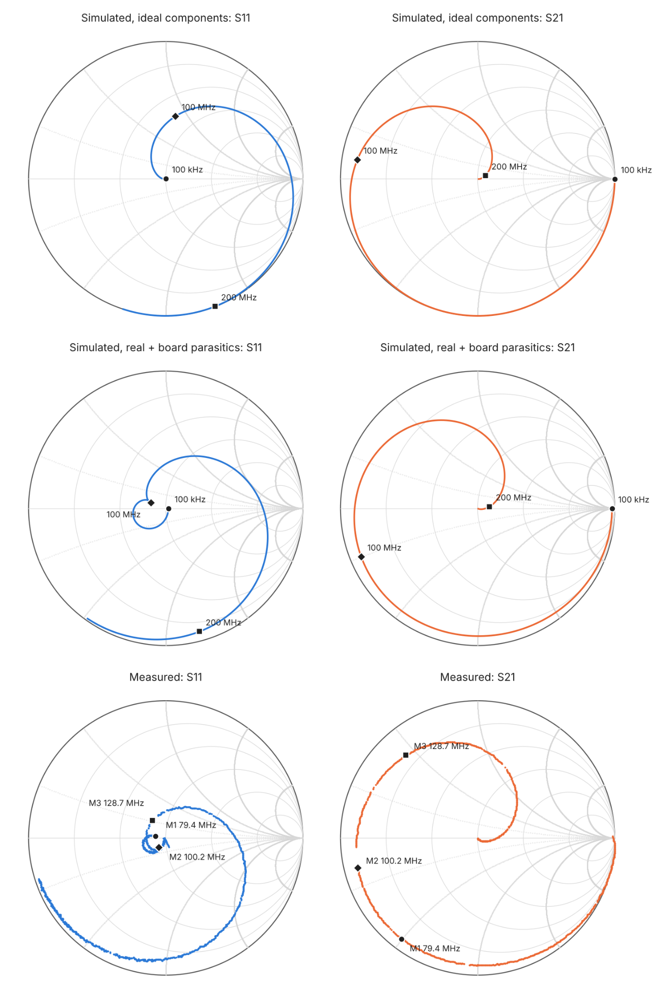

## Modeling the Board

The measurements deviated enough from the ideal simulation that the board itself
had to go into the model. Two additions:

- **1.4 nH in series with each shunt capacitor**, representing the inductance of
  its ground via and pad. This weakens the shunt path at high frequency and
  reduces stopband rejection — visible as the drop from −24 dB to about −21 dB
  at 200 MHz.
- **0.2 pF to ground at each of the three filter nodes**, representing solder-pad
  capacitance. (A generous amount of solder was used.) This adds shunt
  capacitance and pulls the cutoff down slightly.

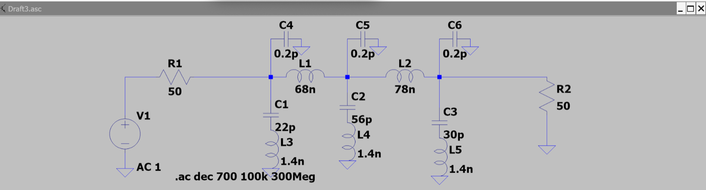

With those in, simulated S₂₁ magnitude and phase tracked the measurement closely
from DC to 300 MHz.

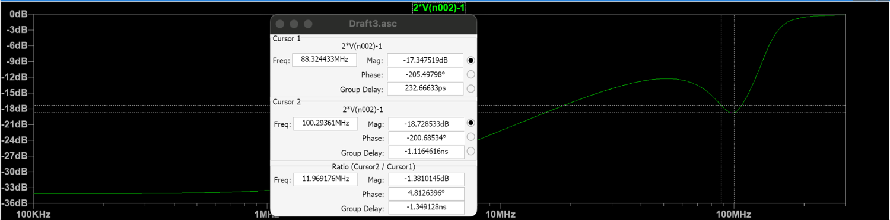

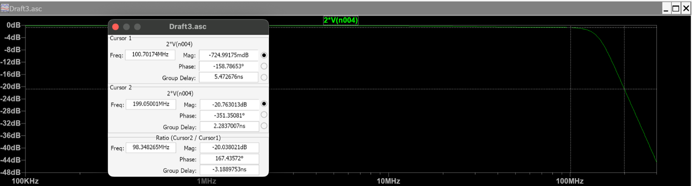

**S₁₁ was the one that resisted.** Its shape differs substantially from the
ideal simulation even after the parasitics are added, although its magnitude
matches the measurement well. Reflection is more sensitive to the details of the
board than transmission is, and the lumped parasitic model only goes so far.

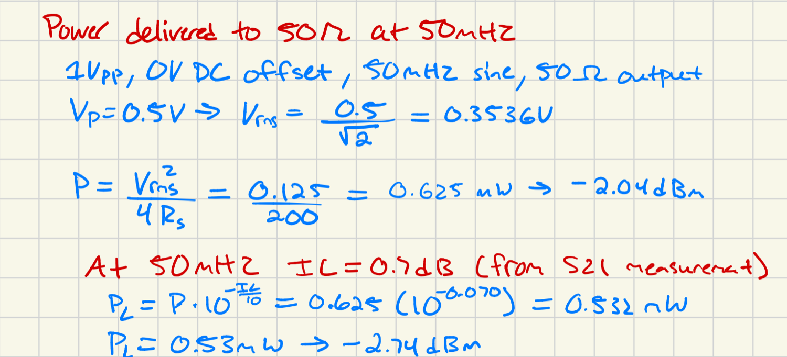

## What I Took Away

The L and C values are a solved problem. Choosing the passband, the stopband,
and the order is the real design decision, and everything after that is the
board: vias, pads, connectors, and solder all shift the response. Pre-computed
values don't guarantee a working filter. As discussed in class, even a small
drill hole in a PCB acts like an inductor — the hole interferes with the
magnetic field of the charge, which is a strange and pleasing thing to have to
account for.

[Full design report with schematics, hand calculations, S-parameter plots, and Smith charts](https://drive.google.com/file/d/1G6pXYdiSLLlvGPR8YGFW2FR-DEqetvIa/view)
