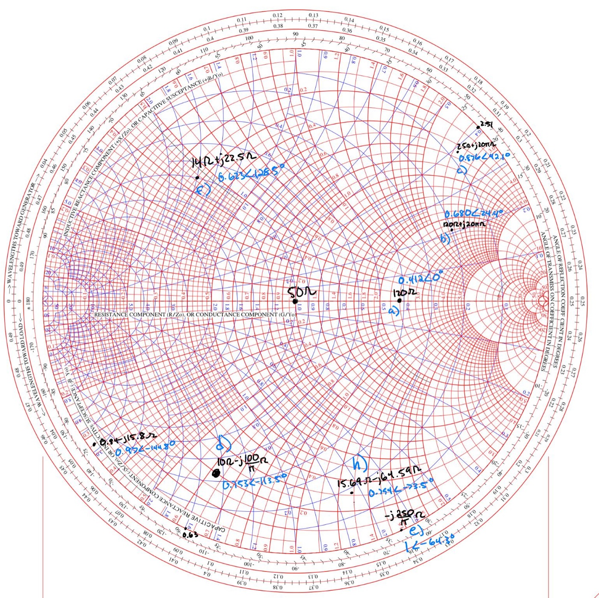
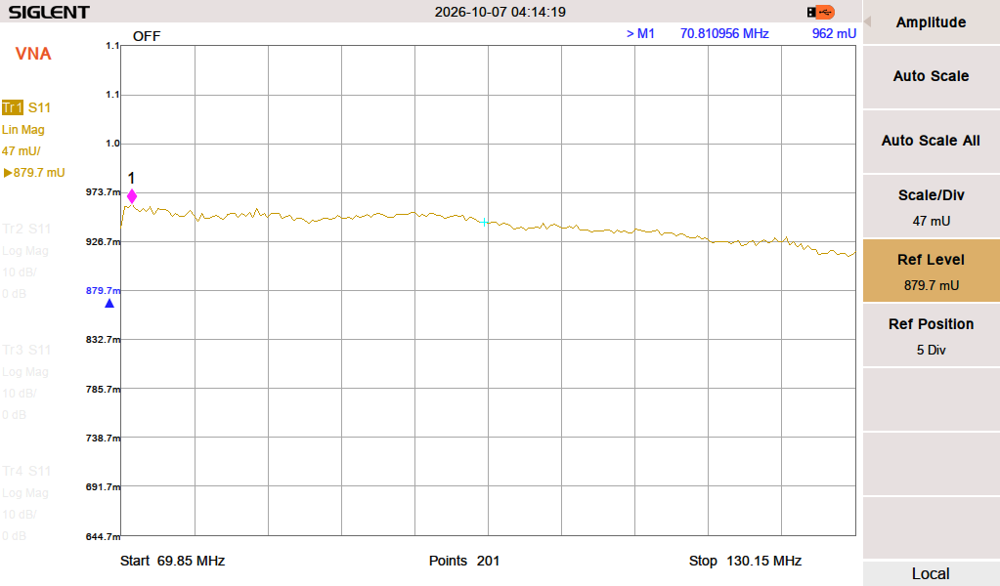
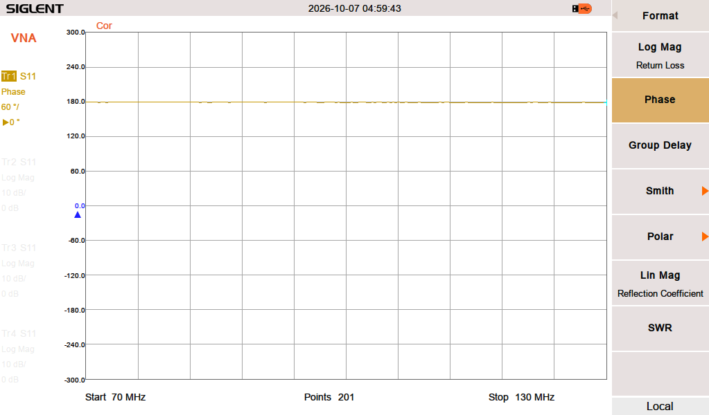
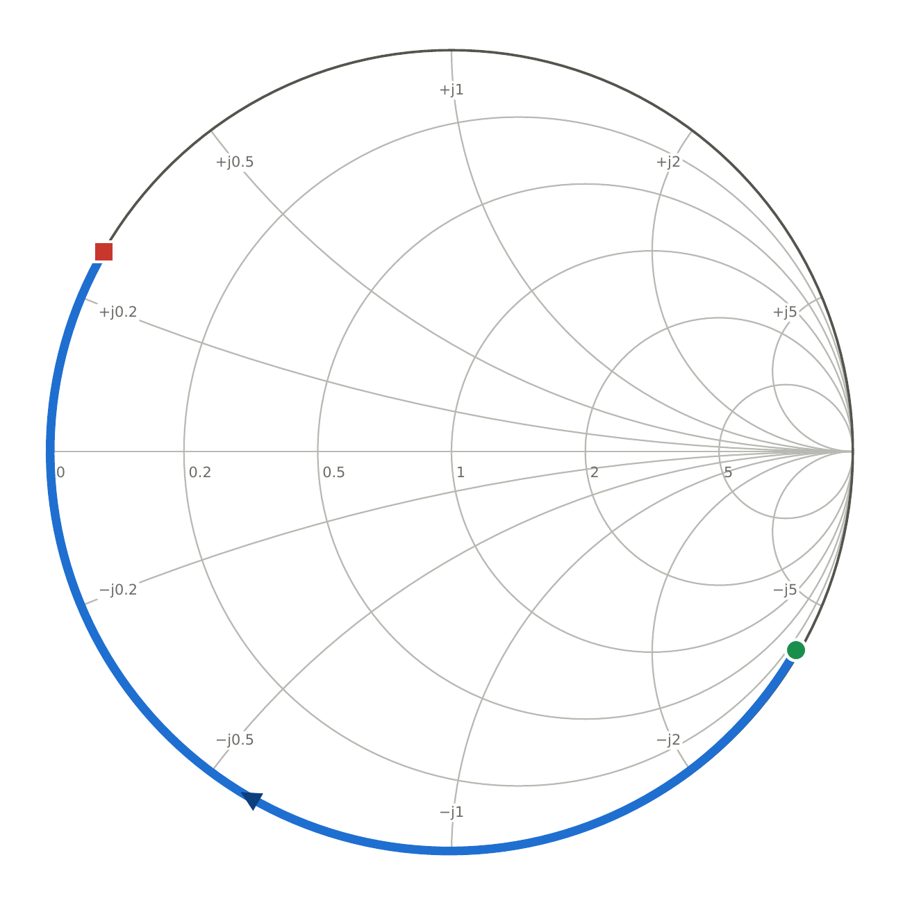
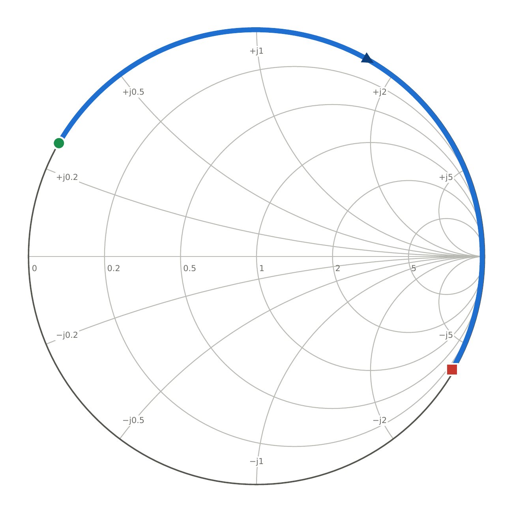
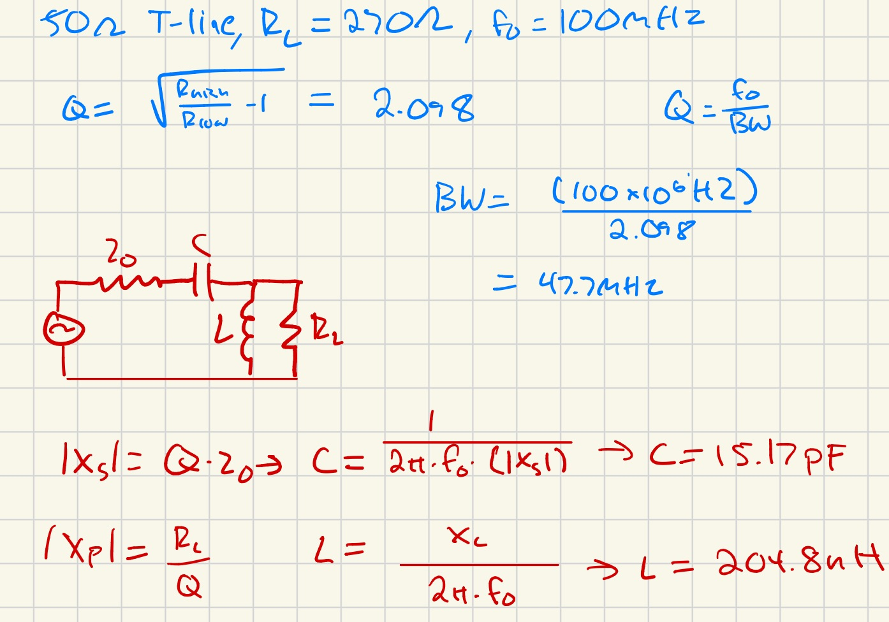
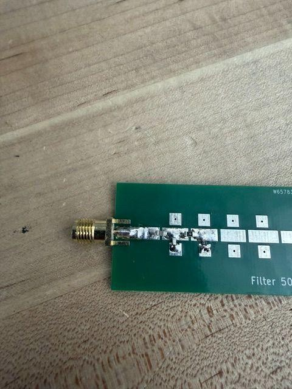
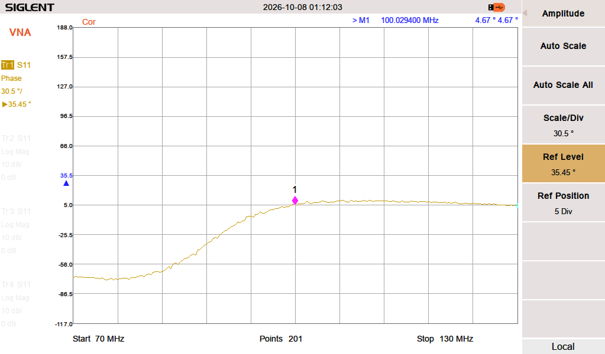
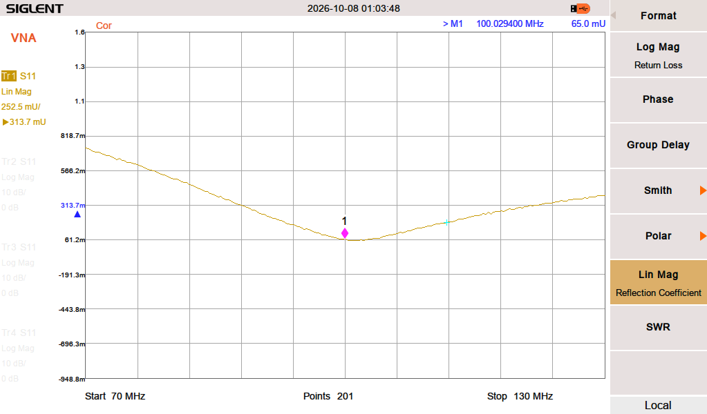

Two things at once: learning to trust a vector network analyzer, and using it to
match a 270 Ω load to a 50 Ω system at 100 MHz.

## Why Calibration Is the Whole Game

Before calibration, a short doesn't sit at Γ = −1 and an open doesn't sit at
Γ = +1. They spiral around the Smith chart with frequency, because the VNA is
measuring **the cable too** — its phase delay, its inductance, its capacitance.
The instrument has no way to know where your circuit begins.

I predicted and then measured S₁₁ over a 70–130 MHz sweep for a 1 m SMA cable
terminated in a short, an open, and a 50 Ω load, plus a 10 m cable into a short.

A matched 50 Ω load is the exception: Γ = 0 regardless, a single point at the
center of the chart, because there is nothing to reflect.

Calibrating with short, open, and load standards (SOL) moves the reference plane
to the end of the cable. After calibration the measurements land where theory
says: short at Γ = −1 on the negative real axis, open at Γ = +1, 50 Ω at the
center.

## Designing the L-Match

For an L-match the quality factor falls out of the impedance ratio alone:

$$Q = \sqrt{\frac{R_{high}}{R_{low}} - 1} = \sqrt{\frac{270}{50} - 1} \approx 2.09$$

Using a series capacitor topology, that gave **15 pF and 220 nH**.

## Build and Tune

Before placing any reactive parts I characterized the bare board with zero-ohm
resistors and the 270 Ω termination, so that whatever the board contributed was
known rather than inferred later.

Then the designed network went on: 15 pF, 220 nH, 270 Ω.

It didn't land on 100 MHz. Reading the phase and magnitude of the measured
S-parameters showed the problem — the board's own capacitance meant the circuit
needed **less** inductance than the calculation called for, not more. Rather
than guess, I put two inductors in parallel to get there:

$$270\ \text{nH} \parallel 470\ \text{nH} = 171.5\ \text{nH}$$

The tuned network reflects **|Γ| = 0.065 at 100.029 MHz** — about −23.7 dB
return loss, VSWR ≈ 1.14.

## The Honest Result

The final matched network was not the designed one. Measured **Q came out 1.59
against a designed 2.09**, computed from the final 170 nH via Q = (270/X)/ω₀.
The board's parasitic capacitance is the reason, and it's the same lesson the
[Butterworth filter](designproject1.qmd) taught from the other direction: the
calculation gets you into the neighborhood, and the network analyzer tells you
which house you're actually standing in.

[Full lab report with Smith charts, VNA captures, and PCB photos](https://docs.google.com/document/d/1W_jZ2hziBq8SbEWpIt9bIS6KlD7Ekut5oyEk0IaTKAU/edit)
